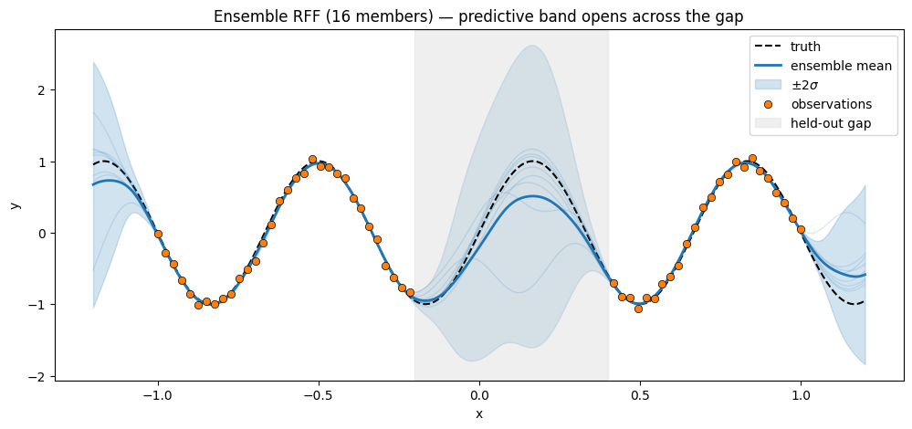
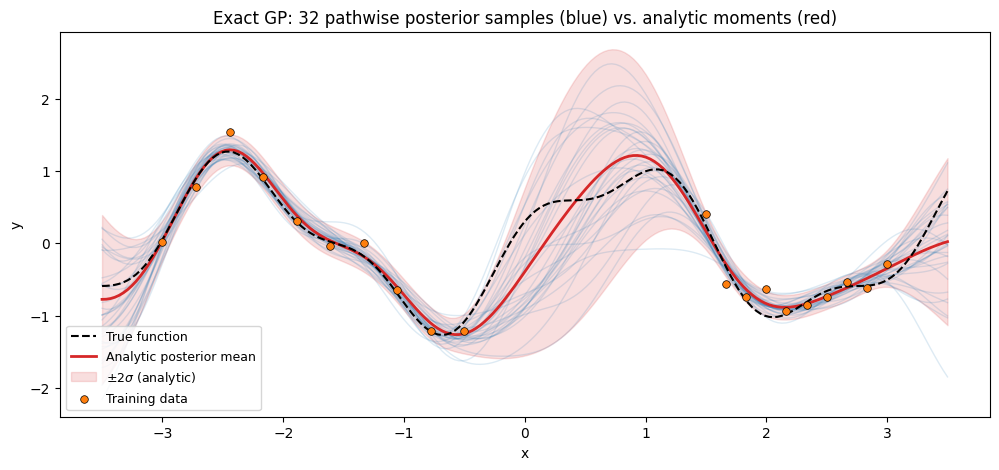
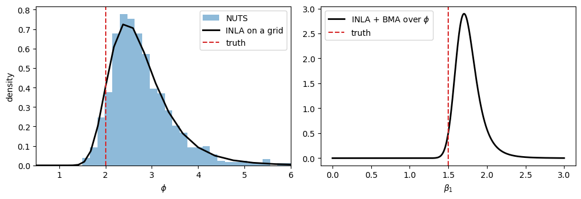
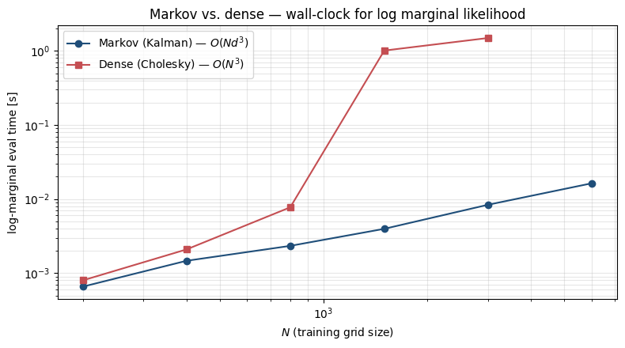

<div align="center">

<picture>
  <source media="(prefers-color-scheme: dark)" srcset="docs/assets/logo-dark.svg">
  
</picture>

**Probabilistic models for JAX: Gaussian processes, Bayesian neural networks, latent Gaussian models, state-space models and extremes as NumPyro models, on Equinox, NumPyro, gaussx, kernellib, geonnax, functax and argminax.**

[](https://github.com/jejjohnson/pyrox/actions/workflows/ci.yml)
[](https://github.com/jejjohnson/pyrox/actions/workflows/lint.yml)
[](https://github.com/jejjohnson/pyrox/actions/workflows/typecheck.yml)
[](https://jejjohnson.github.io/pyrox/)
[](https://codecov.io/gh/jejjohnson/pyrox)
[](https://www.python.org/)
[](LICENSE)
[](https://github.com/astral-sh/ruff)
[](https://github.com/astral-sh/uv)
[](https://pre-commit.com/)

📖 [Documentation](https://jejjohnson.github.io/pyrox/) ·
📓 [Tutorials](https://jejjohnson.github.io/pyrox/regression-masterclass-treeat/) ·
📚 [API reference](https://jejjohnson.github.io/pyrox/reference/) ·
🗂️ [Capability index](https://jejjohnson.github.io/pyrox/capabilities/) ·
🧭 [Design](design_docs/pyrox/README.md)

</div>

---

A map of methane from a cloudy overpass, a station record with a month missing, forty annual maxima and a 100-year question: the data differ, but in each one we infer a function we never saw from noisy values of it. The same few choices decide the answer, namely what we believe about the function, how it produced the data, and which parameters we leave open. pyrox is a workspace of packages that write those choices as parts of one [NumPyro](https://github.com/pyro-ppl/numpyro) model. They all go into the same joint density,

```math
p(\mathbf{y}, \mathbf{f}, \boldsymbol{\theta}) = p(\mathbf{y} \mid \mathbf{f}, \boldsymbol{\theta}) \ p(\mathbf{f} \mid \boldsymbol{\theta}) \ p(\boldsymbol{\theta})
```

where $`\mathbf{y} \in \mathbb{R}^{N}`$ holds the observations, $`\mathbf{f} \in \mathbb{R}^{N}`$ is the latent function at the $`N`$ places they were taken, and $`\boldsymbol{\theta} \in \mathbb{R}^{D_\theta}`$ holds everything else that is unknown (a lengthscale, a noise level, the weights of a network). The packages supply the factors, and NumPyro owns the inference, so NUTS, SVI and `Predictive` run on a model built from any of them.

```python
# Shapes: N = 60 years
# (kernel, times, loc, scale and maxima as in the quickstart; walk, features and
# years as on the docs page "One trend in the extremes, four priors")

# today (pyrox-gp)
# f ~ 𝒩(0, K_θ), one way to write the trend
trend = gp_sample("f", GPPrior(kernel, times[:, None]), whitened=True)
# today (pyrox-lgm)
# f ~ 𝒩(0, Q_τ⁻¹), another
trend = walk.sample(years)
# today (pyrox-nn)
# f = Φ w, with w ~ 𝒩(0, S_θ), and a third
trend = features(times[:, None] - times.mean())
# today (pyrox-xtreme)
# y_n ~ Gumbel(μ_0 + f_n, σ), the same whichever we took
gumbel = GumbelType1GEVD(loc + trend, scale)
numpyro.sample("obs", gumbel.to_event(1), obs=maxima)
```

Most of the machinery belongs to other libraries, and the workspace composes them. A model is made of [`equinox`](https://github.com/patrick-kidger/equinox) modules whose parameters are NumPyro sites, so `jit`, `vmap`, `grad` and every NumPyro handler treat it as any other. The structured linear algebra, the Kalman filters and the sparse precisions are [`gaussx`](https://github.com/jejjohnson/gaussx) on [`lineax`](https://github.com/patrick-kidger/lineax) operators, the kernels are [`kernellib`](https://github.com/jejjohnson/kernellib), the networks are [`geonnax`](https://github.com/jejjohnson/geonnax), the bases and the interpolation are [`functax`](https://github.com/jejjohnson/functax), and the Laplace fits are [`argminax`](https://github.com/jejjohnson/argminax) and [`optimistix`](https://github.com/patrick-kidger/optimistix).

<p align="center"></p>

## 🌟 Highlights

- 🔁 **One model, any inference**: a module declares its sites under stable names such as `Matern.lengthscale`, so the same model function runs under NUTS, SVI with any autoguide, `Predictive` and the NumPyro handlers.
- 🎯 **Functions integrated out**: `gp_factor`, `markov_gp_factor` and `lgssm_factor` add the exact evidence to a model when the noise is Gaussian, `gp_laplace_factor` and `markov_laplace_factor` the Laplace one when it is not, and `inla()` does it for a whole latent Gaussian model.
- ⏱️ **Time series in linear time**: `MarkovGPPrior` writes a temporal Gaussian process as a Kalman filter and smoother, and a mask stands for the gaps in the record.
- 🗺️ **Sparse precisions for maps and areas**: random walks, `Besag` and `BYM2` areal fields and the Matérn `SPDE` keep their precision sparse, with penalised-complexity priors on their hyperparameters.
- 🧠 **Networks that know what they do not know**: Bayesian layers, random Fourier features, neural fields with `NeuralFieldEstimator`, and `last_layer_laplace` for a network that is already fitted.
- 📈 **Extremes as likelihoods**: the GEV and GPD families and the point processes are NumPyro distributions, with return levels that hold for long periods and xarray tools to take block maxima and threshold exceedances.
- 🧱 **Each package on its own**: a network does not pull in the Gaussian processes, pyrox-gauss and pyrox-xtreme do not even need the core, and import-guard tests fail when a package reaches for one it should not.

## 📐 One joint density, seven packages

Each package owns one factor, or one way of writing it. The prior on the function is the factor with the most choice, and four of the packages write it, each in the form that makes its own computation cheap.

| Factor | Written as | Package | Start from |
|---|---|---|---|
| $`p(\boldsymbol{\theta})`$ | sites of a module | [`pyrox`](packages/pyrox/README.md) | `PyroxModule`, `Parameterized` |
| $`p(\mathbf{f} \mid \boldsymbol{\theta})`$ | a covariance | [`pyrox-gp`](packages/pyrox-gp/README.md) | `GPPrior`, `SparseGPPrior` |
| $`p(\mathbf{f} \mid \boldsymbol{\theta})`$ | a sparse precision | [`pyrox-lgm`](packages/pyrox-lgm/README.md) | `LGM`, `inla` |
| $`p(\mathbf{f} \mid \boldsymbol{\theta})`$ | a recursion in time | [`pyrox-ssm`](packages/pyrox-ssm/README.md) | `MarkovGPPrior` |
| $`p(\mathbf{f} \mid \boldsymbol{\theta})`$ | random weights | [`pyrox-nn`](packages/pyrox-nn/README.md) | `DenseReparameterization`, `HSGPFeatures` |
| $`p(\mathbf{y} \mid \mathbf{f}, \boldsymbol{\theta})`$ | tails and events | [`pyrox-xtreme`](packages/pyrox-xtreme/README.md) | `GeneralizedExtremeValueDistribution` |
| any Gaussian one | a distribution on an operator | [`pyrox-gauss`](packages/pyrox-gauss/README.md) | `MultivariateNormal`, `LGSSM` |

**Covariance.** The prior is $`\mathbf{f} \sim \mathcal{N}(\boldsymbol{\mu}, \mathbf{K}_{\boldsymbol{\theta}})`$, with a mean $`\boldsymbol{\mu} \in \mathbb{R}^{N}`$ and a kernel matrix $`\mathbf{K}_{\boldsymbol{\theta}} \in \mathbb{R}^{N \times N}`$. It is the most direct way to say how smooth a function is, in any number of dimensions, and inducing points take it to large $`N`$.

**Precision.** The prior is $`\mathbf{f} \sim \mathcal{N}(\mathbf{0}, \mathbf{Q}_{\boldsymbol{\theta}}^{-1})`$, where $`\mathbf{Q}_{\boldsymbol{\theta}} \in \mathbb{R}^{N \times N}`$ is sparse because a week depends on its neighbours and a district on the districts it borders. It suits models with many additive effects, which `inla()` fits without sampling.

**Recursion.** A state $`\mathbf{z}_n = \mathbf{A}_n \mathbf{z}_{n-1} + \boldsymbol{\eta}_n`$ with $`\mathbf{z}_n \in \mathbb{R}^{D_z}`$, transition $`\mathbf{A}_n \in \mathbb{R}^{D_z \times D_z}`$ and Gaussian noise $`\boldsymbol{\eta}_n \in \mathbb{R}^{D_z}`$ gives $`f_n = \mathbf{h}^\top \mathbf{z}_n`$, with $`\mathbf{h} \in \mathbb{R}^{D_z}`$. It is the same prior as a Matérn covariance over time, and its cost is linear in $`N`$.

**Weights.** The function is a network or a basis with a prior on its weights. It suits many inputs, many data and a function that changes character from place to place, at the price of a prior which is harder to read.

Whichever we take, the latent function can stay in the model as a site, or be integrated out, exactly when the likelihood is Gaussian and with a Laplace approximation when it is not:

```math
p(\mathbf{y} \mid \boldsymbol{\theta}) = \int p(\mathbf{y} \mid \mathbf{f}, \boldsymbol{\theta}) \ p(\mathbf{f} \mid \boldsymbol{\theta}) \ \mathrm{d}\mathbf{f}
```

The factors named in the highlights add its logarithm to a NumPyro model, so that NUTS and SVI only see $`\boldsymbol{\theta}`$.

## 📥 Install

Nothing is on PyPI yet, and the name `pyrox` there belongs to an unrelated project, so `pip install pyrox` installs the wrong package. The packages are installed from this repository with [uv](https://docs.astral.sh/uv/), and they need Python 3.12 or newer. From a clone, one command installs all seven:

```bash
git clone https://github.com/jejjohnson/pyrox.git
cd pyrox
uv sync
```

In your own project, add the package you want. Each one pulls in the others it needs from this repository:

```bash
uv add "pyrox-gp @ git+https://github.com/jejjohnson/pyrox.git#subdirectory=packages/pyrox-gp"
```

kernellib v0.0.22 and argminax v0.0.8 pin older tags of gaussx and geonnax than we need. So for `pyrox-gp`, `pyrox-nn`, `pyrox-lgm` and `pyrox-ssm` add this override to your `pyproject.toml` first, otherwise uv cannot resolve the install; `pyrox`, `pyrox-gauss` and `pyrox-xtreme` need none.

```toml
[tool.uv]
override-dependencies = [
    "gaussx @ git+https://github.com/jejjohnson/gaussx.git@v0.8.0",
    "geonnax @ git+https://github.com/jejjohnson/geonnax.git@v0.0.11",
]
```

The extras are `pyrox[optax]` (ensemble MAP), `pyrox-gp[flows]` (warps from gauss-flows), `pyrox-nn[optax]`, `pyrox-nn[bnf]` and `pyrox-nn[xarray]` (the neural-field estimator and its tables and grids), `pyrox-lgm[xarray]` (labelled marginals), `pyrox-ssm[flows]` and `pyrox-ssm[ensemble]` (warps, and filterax's ensemble Kalman filter), `pyrox-xtreme[threshold]` (quantile-regression thresholds), and `colab` on `pyrox`, `pyrox-gp` and `pyrox-nn` (what the notebooks need). Each package's README says more.

```bash
uv add "pyrox-nn[bnf] @ git+https://github.com/jejjohnson/pyrox.git#subdirectory=packages/pyrox-nn"
```

## 🌡️ Quickstart: a 100-year return level

The data are $`N = 60`$ annual maxima $`y_n`$, at times $`t_n`$ in decades. The model is $`y_n \sim \mathrm{Gumbel}(\mu_0 + f_n, \sigma)`$, with a constant $`\mu_0`$, a scale $`\sigma > 0`$ and a Gaussian-process trend $`\mathbf{f} \sim \mathcal{N}(\mathbf{0}, \mathbf{K}_{\boldsymbol{\theta}})`$, where $`\boldsymbol{\theta}`$ holds the variance $`\sigma_f^2`$ and the lengthscale $`\ell`$ of the kernel $`k_{\boldsymbol{\theta}}`$. We want the 100-year return level $`z_n = F_n^{-1}(1 - 1/100)`$, where $`F_n`$ is the cumulative distribution function in year $`n`$.

```python
import jax
import jax.numpy as jnp
import jax.random as jr
import numpyro
import numpyro.distributions as dist
from numpyro.infer import MCMC, NUTS, init_to_median
from pyrox_gp import GPPrior, Matern, gp_sample
from pyrox_xtreme import GumbelType1GEVD


jax.config.update("jax_enable_x64", True)

# Shapes: N = 60 years; S = 500 posterior draws

# today (pyrox-xtreme)
# y_n ~ Gumbel(30 + 1.5 sin(2π t_n / 8) + t_n / 4, 1)
# → (N,)
times = jnp.arange(60) / 10.0
truth = GumbelType1GEVD(30.0 + 1.5 * jnp.sin(jnp.pi * times / 4) + times / 4, 1.0)
maxima = truth.sample(jr.key(0))

# today (pyrox-gp)
# k_θ, Matérn-3/2 with σ_f², ℓ ~ LogNormal(0, 0.5²)
kernel = Matern(nu=1.5)
kernel.set_prior("variance", dist.LogNormal(0.0, 0.5))
kernel.set_prior("lengthscale", dist.LogNormal(0.0, 0.5))


# user
# y_n ~ Gumbel(μ_0 + f_n, σ), with f ~ 𝒩(0, K_θ)
def model(maxima):
    loc = numpyro.sample("loc", dist.Normal(30.0, 5.0))
    scale = numpyro.sample("scale", dist.LogNormal(0.0, 0.5))
    # today (pyrox-gp)
    trend = gp_sample("f", GPPrior(kernel, times[:, None]), whitened=True)
    # today (pyrox-xtreme)
    gumbel = GumbelType1GEVD(loc + trend, scale)
    numpyro.deterministic("z100", gumbel.return_level(100.0))
    numpyro.sample("obs", gumbel.to_event(1), obs=maxima)


# p(θ, f | y), by NUTS
nuts = NUTS(model, init_strategy=init_to_median)
mcmc = MCMC(nuts, num_warmup=300, num_samples=500, progress_bar=False)
mcmc.run(jr.key(1), maxima)
# 𝔼[z_n | y]
# (S, N) → (N,)
z100 = mcmc.get_samples()["z100"].mean(axis=0)

print(z100[-1].round(1), truth.return_level(100.0)[-1].round(1))
```

This prints `34.0 34.6`, the posterior mean of the return level in the last year and its true value. The kernel declares its own hyperparameters as sites, so `model` never names them. To write the trend another way, replace the `gp_sample` line: [one trend, four priors](https://jejjohnson.github.io/pyrox/four-priors/) does so with pyrox-ssm, pyrox-lgm and pyrox-nn on the same data, and the [methane map](https://jejjohnson.github.io/pyrox/methane-overpass/) is a longer example with one GP.

## 🔬 The packages

| | Package | Import | Holds |
|---|---|---|---|
|  | [`pyrox`](packages/pyrox/README.md) | `pyrox` | the bridge from Equinox to NumPyro, ensembles of MAP and VI fits, the likelihood protocols |
|  | [`pyrox-gp`](packages/pyrox-gp/README.md) | `pyrox_gp` | kernels with priors; exact, sparse, multi-output and non-Gaussian GPs; pathwise samples |
|  | [`pyrox-nn`](packages/pyrox-nn/README.md) | `pyrox_nn` | Bayesian layers, random features, neural fields, last-layer Laplace |
|  | [`pyrox-lgm`](packages/pyrox-lgm/README.md) | `pyrox_lgm` | GMRF components, PC priors, `inla()` |
|  | [`pyrox-ssm`](packages/pyrox-ssm/README.md) | `pyrox_ssm` | Markov GPs, linear and nonlinear state-space models, many sites at once |
|  | [`pyrox-gauss`](packages/pyrox-gauss/README.md) | `pyrox_gauss` | Gaussian NumPyro distributions on gaussx operators |
|  | [`pyrox-xtreme`](packages/pyrox-xtreme/README.md) | `pyrox_xtreme` | GEV and GPD families, point processes, extraction from xarray (formerly xtremax) |

All seven are released, each with its own [version and notes](https://github.com/jejjohnson/pyrox/releases). An arrow below points at what a package imports:

<p align="center">
  <picture>
    <source media="(prefers-color-scheme: dark)" srcset="https://raw.githubusercontent.com/jejjohnson/geostack/main/docs/images/libraries/pyrox_workspace_ecosystem/pyrox_workspace_ecosystem-dark.svg">
    
  </picture>
</p>

Nothing points back up (the core only looks pyrox-nn up for two deprecated names, when asked), and the four in the top row do not import each other. Two of them can still meet in your model, as on the [four priors](https://jejjohnson.github.io/pyrox/four-priors/) page, which passes a pyrox-gp kernel to a pyrox-nn layer. pyrox-xtreme stands alone, so it can be used without the rest.

## 📓 Tutorials

| # | Tutorial | What it shows |
|---|---|---|
| 1 | [Three ways to write a model](https://jejjohnson.github.io/pyrox/regression-masterclass-treeat/) | Plain sites, `PyroxModule` and `Parameterized`, the first of three notebooks |
| 2 | [Ensembles](https://jejjohnson.github.io/pyrox/ensemble-runner-tutorial/) | Many MAP or VI fits under one `vmap` |
| 3 | [Exact GP regression](https://jejjohnson.github.io/pyrox/exact-gp-regression/) and [latent classification](https://jejjohnson.github.io/pyrox/latent-gp-classification/) | The two basic Gaussian-process models |
| 4 | [Random features as networks](https://jejjohnson.github.io/pyrox/rff-as-neural-networks/) | From a GP to a Bayesian layer |
| 5 | [MCMC with INLA](https://jejjohnson.github.io/pyrox/lgm-mcmc-inla/) | A parameter outside the latent Gaussian model |
| 6 | [Kalman and RTS smoothing](https://jejjohnson.github.io/pyrox/markov-gp-kalman/) and [one site](https://jejjohnson.github.io/pyrox/ssm-one-site/) | Markov GPs, and a worked example |
| 7 | [A tour of the EVT distributions](https://jejjohnson.github.io/pyrox/evt-distributions-overview/) and [spatial extremes](https://jejjohnson.github.io/pyrox/spatial-extremes/) | Extremes, up to spatial GEV fields over Spain |

## 🖼️ Gallery

Each plot comes from an executed notebook in the docs.

<table>
  <tr>
    <td width="50%"><a href="https://jejjohnson.github.io/pyrox/rff-as-neural-networks/"></a><br><code>ensemble_map</code> fits sixteen random-feature models, and their band opens where the data stop (<code>pyrox</code>).</td>
    <td width="50%"><a href="https://jejjohnson.github.io/pyrox/gp-pathwise/"></a><br><code>PathwiseSampler.sample_paths</code> draws whole functions from a GP posterior (<code>pyrox-gp</code>).</td>
  </tr>
  <tr>
    <td width="50%"><a href="https://jejjohnson.github.io/pyrox/lgm-mcmc-inla/"></a><br><code>inla</code> on a grid and NUTS on <code>log_posterior_theta</code> give the same posterior (<code>pyrox-lgm</code>).</td>
    <td width="50%"><a href="https://jejjohnson.github.io/pyrox/markov-gp-kalman/"></a><br><code>MarkovGPPrior.log_marginal</code> against a dense Cholesky, in seconds per evaluation (<code>pyrox-ssm</code>).</td>
  </tr>
</table>

## 📖 Documentation

- **[Documentation](https://jejjohnson.github.io/pyrox/)**: the home page, the guides and the executed notebooks, by package.
- **[API reference](https://jejjohnson.github.io/pyrox/reference/)**: one page per public module, generated from the docstrings.
- **[Capability index](https://jejjohnson.github.io/pyrox/capabilities/)**: every public name once, with a one-line summary, together with those of gaussx, kernellib, geonnax and functax.
- **[Building with agents](https://jejjohnson.github.io/pyrox/agents/)**: the Claude Code plugin, and rules to paste into your own project.
- **[Design](design_docs/pyrox/README.md)**: the vision, the boundaries and the decisions. Parts of it predate the split into packages, and the code wins where they differ.

## 🧩 Ecosystem

pyrox is in the GeoML layer of the [GeoStack](https://github.com/jejjohnson/geostack). It owns the probabilistic models and their NumPyro surface, and composes the rest:

| Concern | Owner |
|---|---|
| Modules and filtered transforms | [`equinox`](https://github.com/patrick-kidger/equinox) |
| Sites, handlers, NUTS, SVI and `Predictive` | [`numpyro`](https://github.com/pyro-ppl/numpyro) |
| Structured linear algebra, Kalman filters, GMRFs | [`gaussx`](https://github.com/jejjohnson/gaussx), [`lineax`](https://github.com/patrick-kidger/lineax) |
| Kernels, spectral densities and graphs | [`kernellib`](https://github.com/jejjohnson/kernellib) |
| Network cores and geographic encoders | [`geonnax`](https://github.com/jejjohnson/geonnax) |
| Bases, meshes and interpolation | [`functax`](https://github.com/jejjohnson/functax) |
| Laplace modes, evidence and minimisers | [`argminax`](https://github.com/jejjohnson/argminax), [`optimistix`](https://github.com/patrick-kidger/optimistix) |
| Lanczos spectra for the PC priors | [`matfree`](https://github.com/pnkraemer/matfree) |
| Bijections and warps | [`flowjax`](https://github.com/danielward27/flowjax), [`gauss_flows`](https://github.com/jejjohnson/gauss_flows) (extras) |
| Ensemble Kalman filters | [`filterax`](https://github.com/jejjohnson/filterax) (an extra) |
| Optimisers of the ensemble and estimator fits | [`optax`](https://github.com/google-deepmind/optax) (an extra) |
| Named-axis contractions | [`einx`](https://github.com/fferflo/einx) |
| Labelled arrays and tables | [`xarray`](https://xarray.dev/), [`pandas`](https://pandas.pydata.org/) |

The packages import these libraries, and none of these libraries imports pyrox. One library of the stack imports a package of the workspace: the `population` extra of [plumax](https://github.com/jejjohnson/plumax) builds its source populations on the point processes of pyrox-xtreme.

## 🌳 Repository layout

```
pyrox/
├── pyproject.toml     ← the workspace root, never published
├── packages/
│   ├── pyrox/         ← the bridge and ensemble inference
│   ├── pyrox-gp/      ← src/pyrox_gp and its tests, and so on for each
│   ├── pyrox-nn/
│   ├── pyrox-lgm/
│   ├── pyrox-ssm/
│   ├── pyrox-gauss/
│   └── pyrox-xtreme/
├── docs/              ← one site: MyST prose, notebooks and the API reference
├── design_docs/       ← the design pages
├── plugins/           ← the Claude Code plugins for users of the packages
└── scripts/           ← build_docs.py, capabilities.py
```

## ⚙️ Development

With [uv](https://docs.astral.sh/uv/) installed:

```bash
make install    # every package and dependency group, plus the pre-commit hooks
make test       # every test of every package
make lint       # ruff on the whole repository
make typecheck  # ty, per package
make docs       # build the documentation site into public/ and check its links
```

`make help` lists every target. The rules for contributors and coding agents are in [AGENTS.md](AGENTS.md), with one more per package, and the review checklist is in [CODE_REVIEW.md](CODE_REVIEW.md). The icons come from [`docs/assets/render.py`](docs/assets/render.py).

## 🎓 References

- Rasmussen, C. E., & Williams, C. K. I. (2006). [Gaussian processes for machine learning](https://gaussianprocess.org/gpml/). *MIT Press*.
- Rue, H., Martino, S., & Chopin, N. (2009). [Approximate Bayesian inference for latent Gaussian models by using integrated nested Laplace approximations](https://doi.org/10.1111/j.1467-9868.2008.00700.x). *JRSS B* 71(2), 319–392.
- Hartikainen, J., & Särkkä, S. (2010). [Kalman filtering and smoothing solutions to temporal Gaussian process regression models](https://doi.org/10.1109/MLSP.2010.5589113). *IEEE MLSP*.
- Coles, S. (2001). *An Introduction to Statistical Modeling of Extreme Values*. Springer.

Each package's README lists the papers behind its own methods.

## 📄 License

MIT. See [LICENSE](LICENSE).
